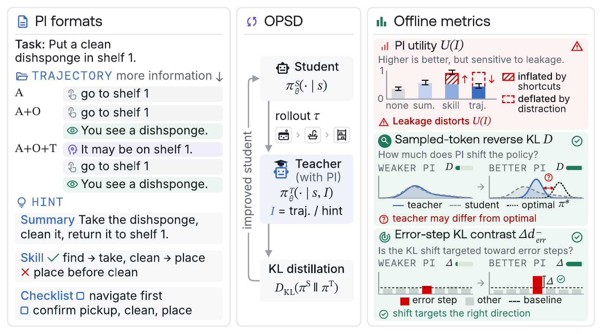

<div align="center">

<h1>Predicting Privileged Information Effectiveness for On-Policy Self-Distillation</h1>

<p><strong>Which privileged information makes self-distillation work for LLM agents, and how to tell before training</strong></p>

<p>
  <a href="https://arxiv.org/abs/2610.22512"></a>
  <a href="https://huggingface.co/datasets/zkjzou/PI-OPSD"></a>
  <!-- TODO: replace https://x.com/TODO with the announcement thread before publishing. -->
  <a href="https://x.com/TODO"></a>
</p>

</div>

## 🔬 Overview

**On-policy self-distillation (OPSD)** trains an agent on its own rollouts against a teacher that is the same model with **privileged information (PI)** in its prompt, such as a successful reference trajectory or a hint written from one. Since the student and teacher differ only in the PI, the PI is the training signal. We ask which PI works for multi-turn agents and whether its value can be predicted before paying for a training run.

We build **16 PIs** (four trajectory formats and three hint formats from GLM-5.2 and Qwen3.7-Plus, plus the student's own hints), train **144 OPSD runs** with three Qwen3 students (4B-Instruct, 4B-Thinking, 30B-A3B-Instruct) on **ALFWorld, AppWorld and τ²-bench retail**, and test three offline metrics:

- **Utility U:** success with the PI in the prompt minus success without it.
- **Sampled-token KL D:** how far the PI moves the model on the student's own tokens.
- **Error-step KL contrast Δd⁻_err:** how much more the PI suppresses the student's tokens at judge-flagged mistakes.



## 🚀 Quick start

The code runs on [SkyRL](https://github.com/NovaSky-AI/SkyRL), installed unmodified from a pinned checkout next to this repository.

```bash
git clone https://github.com/zkjzou/PI-OPSD.git && cd PI-OPSD
git clone https://github.com/NovaSky-AI/SkyRL ../SkyRL-ecdaa946 && git -C ../SkyRL-ecdaa946 checkout ecdaa946
uv sync --frozen --python 3.12 --extra fsdp --extra dev     # 30B: --extra megatron; τ²: add --extra tau2
source .venv/bin/activate
```

Fetch the data, then set up the benchmark simulators:

```bash
export OPSD_DATA_ROOT=$HOME/.cache/opsd/data
python -m opsd.data.fetch --repo zkjzou/PI-OPSD \
    --revision b9b1da0837c93ae981b60aaadbbbbbad2f0b222e --dest $OPSD_DATA_ROOT --tier A
bash scripts/setup/setup_alfworld.sh     # likewise setup_appworld.sh and setup_tau2.sh
```

Train and score one run. Each run is an *arm*, `<bench>/<table>/<student>/<pi>`:

```bash
bash scripts/alfworld/run.sh alfworld/main/4bi/glm_skill                  # vanilla OPSD, 4B-Instruct, GLM-5.2 Skill hint
python -m opsd.eval.window_metric --run-dir runs/alfworld__main__4bi__glm_skill   # best-window pass@1
python -m opsd.recipes list --bench alfworld --long                  # every arm
DRY_RUN=1 bash scripts/alfworld/run.sh alfworld/main/4bi/glm_skill        # print the resolved command, no GPU
```

A 4B run needs one node with 8 × 80 GB GPUs. The 30B student needs two: start Ray with `scripts/common/ray_cluster.sh head` / `worker <head-ip>:6379`, then launch with `RAY_ADDRESS=<head-ip>:6379` on the head (run dir, data root, repository, SkyRL checkout and `.venv` at the same paths on both nodes). τ² needs `OPENAI_API_KEY` (and `OPENAI_BASE_URL` for a non-OpenAI endpoint) for the simulated user; for two-node τ² runs export it before `ray_cluster.sh head`.

## 🧪 Pipeline

Starting from only the benchmark tasks and a model, the stages below reproduce everything. The dataset ships the outputs of stages 1–4 (reference trajectories, PIs, no-hint rollouts and judge labels), so you can also start at stage 5. The stages are (scripts under `scripts/analysis/` unless a path is given; [scripts/analysis/README.md](scripts/analysis/README.md) indexes them):

| Stage | ALFWorld | AppWorld | τ²-bench retail |
|---|---|---|---|
| 1. Reference trajectories (strong model) | `opsd/alfworld/run_alfworld_glm_litellm_local.sh` | `build_appworld_pi_train90.sh` | `run_tau2_pi_gen.sh` (stage 1) |
| 2a. Trajectory PIs (Action, A+Thou., A+Obs., A+Obs.+Thou.) | `python -m opsd.alfworld.build_pi_hint_formats`, `alfworld_cap_many_24k.py`, `alfworld_cap_withthink_24k.py` | `build_appworld_self_hints.py` (renders any won transcripts) | `run_tau2_pi_gen.sh` (stage 2), `build_tau2_retail_pi.py`, `build_tau2_pi_pool.py` |
| 2b. Skill / Summary PIs | `gen_alfworld_analyzer_hints.sh` | `regen_appworld_analyzer_hints.sh` | `gen_tau2_analyzer_hints.sh`, `gen_tau2_plain_summarizer.sh` |
| 2c. Checklist PIs | `run_pi_checklist_hints.sh` | `build_checklist_hints.py` | `run_tau2_checklist_hints.sh` |
| 2d. Self PIs (the student as analyzer) | `fill_self_hints.sh` | `regen_appworld_analyzer_hints.sh` (analyzer = the student) | `gen_tau2_analyzer_hints.sh` with `SELF_URL` (a served student) |
| 3. No-hint student corpus | `opsd/alfworld/run_alfworld_generate_local.sh` | `scripts/appworld/passk.sh` | `opsd/tau2_bench/run_tau2_passk.sh` |
| 4. Error-step labels (LLM judge) | `pi_error_step_label.py` | `pi_error_step_label.py` | `pi_error_step_label_tau2.py` |
| 5. Teacher-forced scoring of each PI | `run_pi_positions_alf_new8_local.sh` | `run_appworld_pi_positions.sh` | `run_tau2_pi_positions.sh` |
| 6. Hinted utility rollouts | `run_alfworld_pi_utility.sh` | `scripts/appworld/pi_utility.sh` | `opsd/tau2_bench/run_tau2_pi_utility.sh` |
| 7. OPSD training + best window | `scripts/alfworld/run.sh <arm>` | `scripts/appworld/run.sh <arm>` | `scripts/tau2/run.sh <arm>` |

## 📏 PI metrics

Every stage-5 driver wraps the scorer `python -m opsd.alfworld.analyze_pi_positions` (`--trajectories <corpus> --pis <name>=<hint.json>,... --model-path <student> --benchmark <bench> --out-dir <cell>`, sharded over GPUs, then `--merge`), which writes `<cell>/rows.parquet`. Point the metric scripts at your cells with `PI_GRID_ROOT=<dir holding the cells>` and at the labels with `PI_LABELS_ROOT` (default: the shipped `$OPSD_DATA_ROOT/<bench>/pi_metrics/error_labels`).

| Metric | ALFWorld | AppWorld | τ²-bench retail |
|---|---|---|---|
| **D** (sampled-token reverse KL) | `python scripts/analysis/alf_pi_divergence_block.py --grid $PI_GRID_ROOT` | `python scripts/analysis/build_appworld_traindev_pi_table.py --grid $PI_GRID_ROOT` | `python scripts/analysis/gen_tau2_matched132_k2_table.py` |
| **Δd⁻_err** (error-step KL contrast) | `python scripts/analysis/pi_error_step_balanced.py --benches alfworld` | `python scripts/analysis/pi_error_step_appworld_traindev.py` | `python scripts/analysis/gen_tau2_matched132_k2_table.py` |
| **U** (utility) | `python -m opsd.alfworld.aggregate_utility_delta --root <utility out>` | `python scripts/analysis/appworld_utility_both_k.py --utility-root <utility out>` | `TAU2_UTIL_ROOT=<utility out> python scripts/analysis/gen_tau2_matched132_k2_table.py` |

Correlating a metric with OPSD performance takes `--targets <csv>` (columns `bench,student,pi,pass1`), built from `opsd.eval.window_metric` over your vanilla-OPSD runs.

**ALFWorld-Passcode** (cheatable verifier): `build_alfworld_passcode_hints.py` → train `scripts/alfworld/run.sh alfworld/passcode/4bi/<pc_key|pc_rawkey|pc_rawwrong|pc_wrongraw>` → utility `run_alf_passcode_utility.sh` → `alf_passcode_report.py`. **Corrupted-PI controls** (ALFWorld): `build_pi_null_tiers.py --tiers n3` (another task's trajectory, arm `alfworld/null/4bi/null_task`), `build_pi_crossdomain_hints.py` with τ² + AppWorld donors (a trajectory from another benchmark, `alfworld/null/4bi/null_xdomain`), `build_selfwrong_hints.py` (the student's own failed rollout, `alfworld/selfwrong/4bi/self_aot`). **Per-task PI selection**: score the candidate pool (stage 5), build the per-task hint file with `pi_mix_select_build.py` / `pi_self16_select_build.py`, then train `scripts/alfworld/run.sh alfworld/selection/4bi/<pool>/...`.

## 📝 Citation

```bibtex
@article{zou2026predicting,
  title   = {Predicting Privileged Information Effectiveness for On-Policy Self-Distillation},
  author  = {Zou, Kaijian and Penaloza, Emiliano and Rezaei, MohammadHossein and Gunjal, Anisha and Raghavendra, Mohit and Wang, Lu and He, Yunzhong and Mahmoud, Anas},
  journal = {arXiv preprint arXiv:2610.22512},
  year    = {2026}
}
```

## 📄 License

The code is released under [Apache-2.0](LICENSE). SkyRL (Apache-2.0) is an unmodified external dependency; files adapted from it are listed in [ADAPTED_FROM_SKYRL.md](ADAPTED_FROM_SKYRL.md). [NOTICE](NOTICE) credits the benchmarks and the third-party model outputs in the dataset. AppWorld-derived data is distributed only in encrypted form, as AppWorld's license requires.
